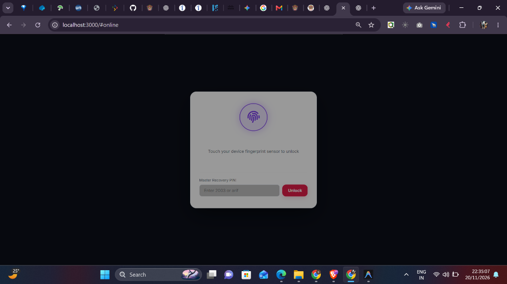
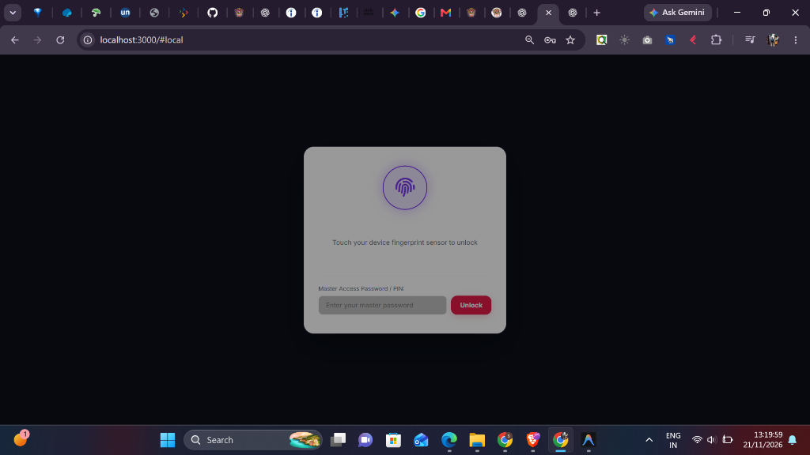
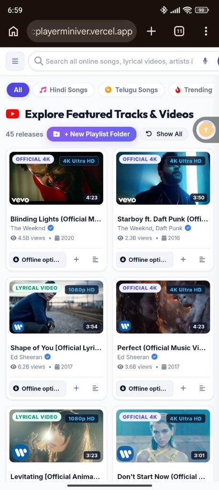

# AK Media Studio – Personal Cloud Media Ecosystem & Web Studio

> **High-Performance Cross-Platform Personal Media Management Platform & Web Studio**  
> Powered by React Native (Expo SDK 58), TypeScript, Node.js Native Web Studio, Supabase, PostgreSQL (100% RLS Enforced), Hardware Biometrics, and Client-Side Zero-Knowledge Encryption.

---

## 🌐 Hosted Production URLs & Repository

* **🚀 Production Live Hosted Web App:** [https://musicplayerminiver.vercel.app](https://musicplayerminiver.vercel.app)  
* **🔗 Custom Domain / Secondary Alias:** [https://ak-media-studio.vercel.app](https://ak-media-studio.vercel.app)
* **🐙 GitHub Repository:** [https://github.com/AK1921/music_player_miniver](https://github.com/AK1921/music_player_miniver)
* **📡 Supabase Keep-Alive Health Endpoint:** [https://musicplayerminiver.vercel.app/api/keepalive](https://musicplayerminiver.vercel.app/api/keepalive)

---

## 📸 Application Portal & Screenshots

### 1. Desktop Web Studio Portal
The full-featured desktop web workstation featuring the collapsible dark/light sidebar, fluid search bar with live YouTube queries, light & OLED theme switcher, cloud sync badge, media upload center, and persistent bottom audio/video player.



---

### 2. Responsive Mobile & Tablet Web Portal
The mobile-optimized interface with a single-row sticky header (hamburger drawer toggle, auto-expanding search input, voice microphone, quick theme palette selector, and cloud sync trigger) running over the active YouTube video feed.



---

### 3. Android Mobile Application – Online Music & Video Hub
The native Android mobile app running on Expo SDK 58 featuring curated music cards, instant high-res YouTube thumbnails, category filter chips (Trending, Pop, Hindi, Telugu, Lofi, Workout), and background-capable audio playback.



---

## 🛠️ How It Works: Architecture & End-to-End Workflow

AK Media Studio is engineered with an isolated dual-client architecture sharing a centralized cloud synchronization backbone:

```
┌────────────────────────────────────────────────────────────────────────┐
│                        AK MEDIA STUDIO ECOSYSTEM                       │
└───────────────────────────────────┬────────────────────────────────────┘
                                    │
           ┌────────────────────────┴────────────────────────┐
           ▼                                                 ▼
┌──────────────────────┐                          ┌──────────────────────┐
│   WEB STUDIO PORTAL  │                          │  ANDROID MOBILE APP  │
│  (Pure JS / HTML5)   │                          │ (Expo SDK 58 / TS)   │
├──────────────────────┤                          ├──────────────────────┤
│ • Local Media Upload │                          │ • Local Device Media │
│ • VLC Video Cinema   │                          │ • YouTube WebView Pl.│
│ • Web Audio Player   │                          │ • Expo Audio Engine  │
│ • Client AES-256     │                          │ • Hardware Biometrics│
│ • Translate & Calc   │                          │ • Native Playlists   │
└──────────┬───────────┘                          └──────────┬───────────┘
           │                                                 │
           └────────────────────────┬────────────────────────┘
                                    │
                                    ▼
       ┌────────────────────────────────────────────────────────┐
       │             SUPABASE CLOUD & BACKEND APIS              │
       ├────────────────────────────────────────────────────────┤
       │ • PostgreSQL with Row-Level Security (RLS)             │
       │ • User Profiles, Playlists & Recent Track Sync         │
       │ • Vercel Serverless Scraper (/api/youtube-search)      │
       │ • Automated Keep-Alive Cron Engine (/api/keepalive)    │
       └────────────────────────────────────────────────────────┘
```

### 1. Web Studio Workstation (`/web`)
* **Local Media Player & Storage**:
  - IndexedDB and browser sandbox storage for local tracks, videos, and playlists.
  - Full-featured audio engine with seek bar, duration tracking, repeat/shuffle, and live HTML5 Canvas audio frequency visualizer.
  - VLC-style dedicated video cinema theater with Picture-in-Picture (PiP) mini-player support.
* **Online YouTube Stream Hub**:
  - Live query resolution via the `/api/youtube-search` serverless proxy function.
  - Zero-quota, free YouTube scraper engine combined with verified playable fallback catalog.
  - Instant modal video player with floating overlay dismiss.
* **AK Private Vault**:
  - Client-side zero-knowledge encryption using Web Crypto API.
  - Protected by biometric prompt / user-defined master passcode.
* **Google Translate Studio**:
  - Voice-to-text input and natural text-to-speech audio playback supporting Indian and global languages.
* **Smart Calculator**:
  - Clean floating scientific and financial calculator with theme-adaptive styling.

### 2. Android Mobile Application (`/src`)
* **Mobile-First Music Hub (`src/app/(tabs)/music.tsx`)**:
  - **Online Tab**: Contacts the cloud serverless endpoint (`https://musicplayerminiver.vercel.app/api/youtube-search`) for real-time YouTube music search with full video IDs, thumbnails, artist metadata, and durations.
  - **Embedded Player**: Seamless playback via `YouTubePlayerModal` utilizing the YouTube IFrame API (`baseUrl: 'https://www.youtube.com'`).
  - **Local Music**: Background audio streaming powered by `expo-audio` with Android Media3 lock-screen controls.
  - **Playlists & Recents**: Offline caching and cloud sync for instant playlist recovery across devices.
* **Security & Biometrics (`src/app/(tabs)/vault.tsx`)**:
  - Native fingerprint and Face ID authentication via `expo-local-authentication`.

---

## ⏰ Supabase Inactivity Pausing & Automated Keep-Alive Cron Job

### Why Supabase Pauses Free-Tier Accounts
On Supabase's **Free Tier**, any project that does not receive API traffic or database queries for **7 consecutive days** is automatically **paused** by Supabase to conserve computing resources.
* **When paused:** Database queries time out, Auth sign-in fails, and DNS resolution fails (`getaddrinfo ENOTFOUND`).
* **The Manual Fix:** The project owner must log into [supabase.com/dashboard](https://supabase.com/dashboard) and click **"Restore project"** (takes 2–3 minutes).

### How Our Automated Keep-Alive System Prevents Pauses
To ensure your Supabase database stays awake indefinitely even if you do not open the app for weeks, two automated keep-alive mechanisms are built directly into this repository:

#### 1. GitHub Actions Scheduled Cron Workflow (`.github/workflows/supabase-keepalive.yml`)
* **Runs Every 3 Days at 04:00 UTC** (`cron: '0 4 */3 * *'`).
* Fully automated via GitHub's free scheduled runners (no local computer or server required).
* Pings both the hosted `/api/keepalive` serverless endpoint and the Supabase `/rest/v1/` API directly.
* Because it queries the database every 3 days, the 7-day inactivity timer is continuously reset and **your Supabase project will never pause**.
* **Manual Trigger:** Can also be run manually anytime by going to your GitHub repo ➔ **Actions** ➔ **Supabase Keep-Alive Cron Job** ➔ **Run workflow**.

#### 2. Vercel Serverless Endpoint & Vercel Cron (`api/keepalive.js` & `vercel.json`)
* Endpoint: `/api/keepalive`
* Accessible via: `https://musicplayerminiver.vercel.app/api/keepalive`
* Vercel Cron is configured in `vercel.json` with the schedule `0 4 */3 * *`.
* You can also paste `https://musicplayerminiver.vercel.app/api/keepalive` into free uptime monitors (e.g., [cron-job.org](https://cron-job.org) or [UptimeRobot](https://uptimerobot.com)) to ping it every 1 to 3 days for extra redundancy.

#### 3. Private Credentials & Secure Configuration
> [!IMPORTANT]
> **No passwords or private keys are committed to this repository.**  
> Access is restricted to you alone through environment variables:
* In GitHub Repository: Go to **Settings ➔ Secrets and variables ➔ Actions** and add:
  - `SUPABASE_URL`: `https://your-project-id.supabase.co`
  - `SUPABASE_ANON_KEY`: `your-anon-public-key`
* If the project was already paused in Supabase before setting up the cron job, simply log in to [supabase.com](https://supabase.com), click **Restore project** once, and the keep-alive cron will keep it active permanently from then on.

---

## ⚡ Quick Start: Running the Applications

### 🌐 1. Run the Web Application Locally
To run the full-featured desktop Web Studio with local offline media library, YouTube music feed, VLC-style video theater, Picture-in-Picture (PiP), Google Translation studio, smart calculator, and private vault:

```bash
# Install dependencies
npm install

# Start the Web Studio server (Port 3000)
npm run web:app
```
Open your browser at **[http://localhost:3000](http://localhost:3000)**.

> **Tip:** You can also use `npm run web:serve`. Both commands launch the native zero-dependency HTTP server (`web/server.js`) with live search proxy, translation services, local file streaming, and the `/api/keepalive` health check.

---

### 📱 2. Run the Android Mobile Application
To run the Android app locally in Expo Go or an Android Emulator:

```bash
# Start the Metro Bundler & Expo dev server
npx expo start
```
- Press **`a`** in the terminal to launch on a connected Android device or Android Emulator.
- Or scan the QR code using the **Expo Go** app on your Android phone.

---

### 📦 3. Build Android Standalone APK (Preview / Installable Build)
To generate an installable standalone APK for direct installation on any Android phone without needing Expo Go or a computer:

```bash
# Generate standalone installable Android APK with EAS
npx eas-cli build -p android --profile preview
```

To build a production Android App Bundle (.aab) for Google Play Store release:
```bash
npx eas-cli build -p android --profile production
```

---

## 🚀 Deploying Web Studio to Vercel

The project is pre-configured with `vercel.json` and Serverless API functions in `/api` (`/api/youtube-search`, `/api/translate`, `/api/keepalive`):

1. **Deploy via Vercel CLI**:
   ```bash
   npx vercel --prod
   ```
2. **Or Deploy Automatically via GitHub**:
   - Every push to the `main` branch of `https://github.com/AK1921/music_player_miniver` automatically triggers a zero-downtime production deployment on Vercel.
   - Root directory: `./` (Vercel automatically detects `vercel.json` and routes `/` to `/web/index.html`).

---

## 🧪 Verification & Typechecking

Run TypeScript strict typecheck:
```bash
npx tsc --noEmit
```

Run Expo Doctor diagnostic check:
```bash
npx expo-doctor
```

---

## 📄 License
MIT License. Built for personal cloud media independence.
